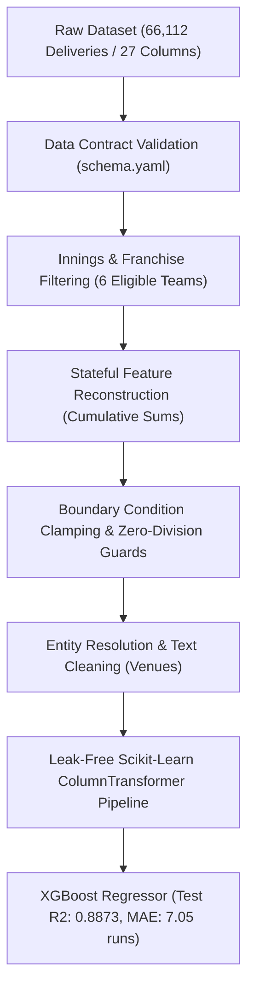

# PSL Score Predictor: Production Data Preprocessing & MLOps Pipeline

[](https://www.python.org/)
[](tests/)
[](https://github.com/psf/black)
[](https://xgboost.readthedocs.io/)
[](LICENSE)

An enterprise-grade, end-to-end Machine Learning and Data Engineering pipeline designed to predict first-innings final scores in **Pakistan Super League (PSL) T20 cricket matches (2016–2024)** from real-time ball-by-ball match states.

This project specifically highlights **advanced data preprocessing, time-series state reconstruction, data contract validation, and leak-free feature pipelines** for complex, event-driven tabular data.

---

## 📌 Executive Summary & Business Problem

In live sports analytics, raw data arrives as **high-velocity, granular event logs** (deliveries/balls bowled). A raw delivery row does not state the match context, current score, wickets fallen, or run rate. 

Furthermore, historical logs span 9 seasons across international venues, containing entity name discrepancies, missing targets, boundary conditions (super overs, extras), and sparse columns.

### Objective
Engineer a modular, production-grade pipeline that ingests **66,112 raw ball-by-ball deliveries**, validates schema integrity, reconstructs live cumulative match states without lookahead bias, and trains an **XGBoost regression pipeline** achieving **7.05 MAE** (Mean Absolute Error).

---

## 🔬 Data Preprocessing & Engineering Highlights

This project showcases production-level data engineering practices that go beyond simple notebook cleaning:



### 1. Schema Contract Validation (`config/schema.yaml`)
Incoming raw files are validated against a strict data contract before any downstream transformation executes. Missing columns or type mismatches raise contextual custom exceptions ([`MyException`](src/exception/__init__.py)) capturing file names and line numbers.

### 2. Stateful Time-Series Reconstruction
* **Dynamic Match Totals**: Reconstructed the running innings total using multi-level grouped cumulative sums:
  $$\text{current\_score} = \sum \text{total\_runs} \quad \text{grouped by } (\text{match\_id}, \text{inning})$$
* **Wicket Depletion Tracker**:
  $$\text{wickets\_remaining} = 10 - \sum \text{is\_wicket} \quad \text{clipped to } [0, 10]$$

### 3. Mathematical Edge-Case & Boundary Guards
* **Delivery Counter**: Standard T20 matches have 120 legal balls. Computed legal balls remaining:
  $$\text{balls\_remaining} = 120 - ((\text{over} - 1) \times 6 + \text{ball})$$
  Clamped to $[0, 120]$ to safeguard against super overs or delivery counter anomalies.
* **Current Run Rate (CRR) Division-by-Zero Protection**: On ball 0 of an innings, division by $(\text{balls\_bowled} = 0)$ is guarded using vectorized conditions:
  $$\text{CRR} = \begin{cases} \frac{\text{current\_score}}{\text{balls\_bowled}} \times 6 & \text{if } \text{balls\_bowled} > 0 \\ 0.0 & \text{otherwise} \end{cases}$$

### 4. Entity Resolution & Text Canonicalization
Real-world match logs record stadium names inconsistently (*"Gaddafi Stadium, Lahore"*, *"Gaddafi Stadium"*, *"National Stadium Karachi"*). The text cleaning stage standardizes venue tokens into canonical city-level categories to prevent high-cardinality sparse matrix explosion.

### 5. Leak-Free Pipeline Architecture
To eliminate data leakage between train and holdout validation sets:
* Categorical features (`venue`, `batting_team`, `bowling_team`) are transformed using `OneHotEncoder(drop='first', handle_unknown='ignore')`.
* Numerical features (`balls_remaining`, `current_score`, `wickets_remaining`, `crr`) are scaled using `StandardScaler()`.
* Both are bundled inside a single scikit-learn `Pipeline`, ensuring all scalers and encoders are fit **strictly on training splits**.

---

## 📊 Before & After: Data Transformation

| Dimension | Raw Input Data (`data/raw/`) | Processed Feature Store (`data/processed/`) |
|---|---|---|
| **Volume** | 66,112 ball delivery logs | 34,227 first-innings decision states |
| **Columns** | 27 sparse, unnormalized columns | 7 dense, engineered features + target |
| **Entities** | Free-form strings, multiple stadium variants | Normalized categorical team & venue tokens |
| **State** | Stateless delivery events | Live reconstructed match situation |
| **Target** | None (embedded across match rows) | Explicit total innings runs ($y$) |
| **Data Leakage Risk** | High (if fit before split) | Zero (enforced via `ColumnTransformer`) |

### Feature Matrix Overview

| Feature | Type | Description |
|---|---|---|
| `venue` | Categorical | Normalized host venue / city |
| `batting_team` | Categorical | One of 6 PSL franchises batting |
| `bowling_team` | Categorical | One of 6 PSL franchises bowling |
| `current_score` | Numerical | Total runs accumulated by batting team so far |
| `balls_remaining` | Numerical | Legal balls left in the innings ($120 \to 0$) |
| `wickets_remaining` | Numerical | Wickets in hand ($10 \to 0$) |
| `crr` | Numerical | Current Run Rate per over |
| **`target`** | **Numerical (Target)** | **Final 1st-innings total score** |

---

## 📈 Model Performance & Evaluation

Trained on 27,381 match states and evaluated against a holdout test set of 6,846 states:

| Metric | Score | Interpretation |
|---|---|---|
| **$R^2$ Score (Test)** | **0.8873** | Explains ~89% of final score variance across matches |
| **Mean Absolute Error (MAE)** | **7.05 runs** | Predictions are within ~7 runs of final total |
| **Root Mean Squared Error (RMSE)** | **10.58 runs** | Low penalty on large outlier predictions |
| **$R^2$ Score (Train)** | **0.9233** | Strong generalization with minimal overfitting |

---

## 🏗️ Repository Architecture

```
PSL-SCORE-PREDICTOR/
├── config/
│   ├── config.py                 # Central path constants & logging configuration
│   └── schema.yaml               # Formal data contract & feature specifications
├── data/
│   ├── raw/                      # Original ball-by-ball dataset (DVC tracked)
│   └── processed/                # Cleaned, engineered feature dataset
├── models/
│   └── psl_pipeline.pkl          # Serialized production ColumnTransformer + XGBoost model
├── src/
│   ├── connections/
│   │   └── s3_connection.py      # AWS S3 cloud storage connector
│   ├── data/
│   │   └── data_ingestion.py     # Data loader & schema validation engine
│   ├── features/
│   │   └── feature_engineering.py# Feature pipeline & match state aggregations
│   ├── models/
│   │   └── train_model.py        # XGBoost pipeline training, evaluation & pickle I/O
│   ├── exception/
│   │   └── __init__.py           # Custom exception with safe traceback diagnostics
│   └── utils/
│       └── logger.py             # Rotating file logger (5 MB threshold, 3 backups)
├── tests/
│   ├── test_data.py              # Unit tests for schema, validation & features
│   └── test_models.py            # Unit tests for pipeline fitting & serialization
├── notebooks/                    # Research and exploratory data analysis
├── Dockerfile & docker-compose   # Containerized deployment for Jupyter & MLflow
├── Makefile                      # Standardized automation commands
├── params.yaml                   # Model and data split hyperparameters
├── pyproject.toml & setup.cfg    # Build system, black, mypy & pytest coverage configs
├── requirements.txt              # Production dependencies
└── main.py                       # Orchestrated 4-stage pipeline execution
```

---

## 🚀 Quick Start & Installation

### 1. Clone the Repository
```bash
git clone https://github.com/ashrafkhanofficial/PSL-SCORE-PREDICTOR--END-TO-END-MLOPS-PROJECT.git
cd PSL-SCORE-PREDICTOR--END-TO-END-MLOPS-PROJECT
```

### 2. Set Up Virtual Environment (Python 3.10)
```bash
# Using Conda:
conda create -p .\.venv python=3.10 -y
conda activate .\.venv

# Or using Python venv:
python -m venv .venv
.\.venv\Scripts\activate
```

### 3. Install Dependencies
```bash
pip install -r requirements.txt
pip install -r requirements-dev.txt
```

### 4. Run the End-to-End Pipeline
```bash
python main.py
```

### 5. Run the Automated Test Suite
```bash
pytest --verbose --cov=src --cov-report=term-missing
```

---

## 🛠️ Tech Stack & Tools

* **Data Manipulation**: `pandas`, `numpy`
* **Machine Learning**: `scikit-learn`, `xgboost`, `catboost`
* **Data Contracts & Config**: `pyyaml`, `schema.yaml`
* **Testing & Quality**: `pytest`, `pytest-cov`, `black`, `flake8`, `mypy`
* **MLOps & Storage**: `DVC`, `boto3` (AWS S3), `MLflow`, `Docker`
* **Logging & Diagnostics**: Python `logging.handlers.RotatingFileHandler`, custom traceback handlers

---

## 👤 Author & Freelance Services

**Ashraf Khan**  
*Specialist in AI/ML Data Preprocessing, Feature Engineering, and MLOps Pipelines.*

* Available for freelance projects involving:
  * Raw and messy tabular / time-series data cleaning
  * Automated data contract validation and schema enforcement
  * Feature engineering & leak-free scikit-learn preprocessing pipelines
  * Production ML model training and deployment

---

## 📄 License
This project is licensed under the MIT License - see the [LICENSE](LICENSE) file for details.